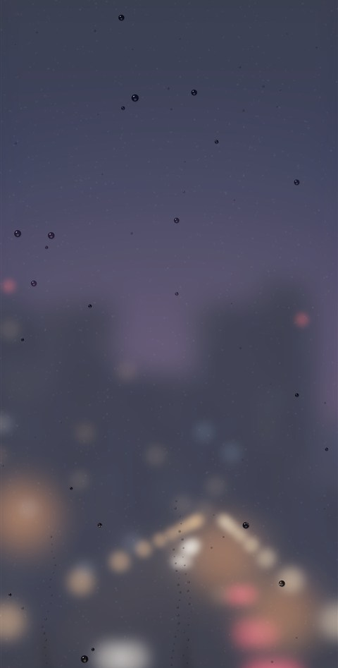
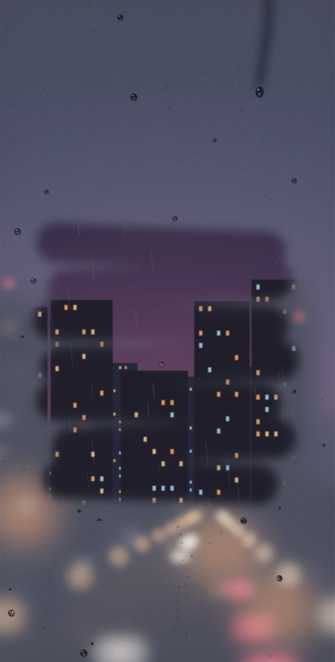
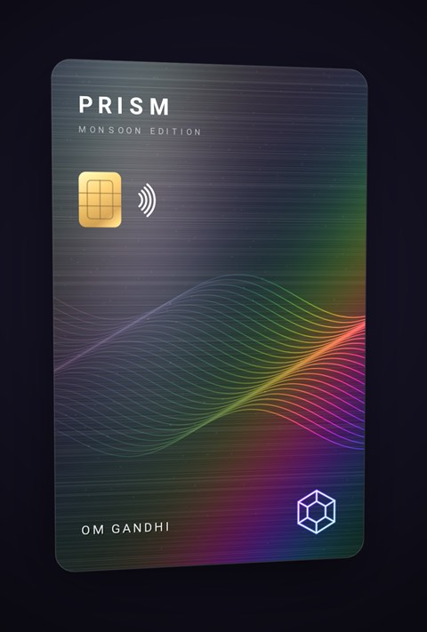
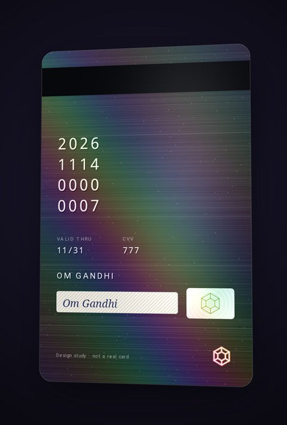

# React Native Interactions

Big, full-screen interactions built with React Native, Skia and Reanimated. Each one lives in its
own folder, so you can read it, run it and borrow from it.

## Monsoon Window

<p align="center">
  
  &nbsp;&nbsp;
  
</p>

A foggy window on a monsoon night. Wipe the fog with your finger and the street behind it comes
into focus; leave it, and the fog slowly creeps back.

- **Wipe** the glass to clear the fog, with a light haptic tick like a finger on wet glass.
- **Watch** heavy drops run down in stops and starts, swallowing smaller ones and leaving trails.
- **Tilt** the phone to steer the running drops and the rain (needs a real device).
- **Double-tap** for lightning, with thunder you feel through haptics.

### How it works

- **No image files.** The city is generated from a seed: towers, lit windows, street lamps, cars,
  neon signs and reflections on the wet road. It's drawn once to an offscreen image when the
  screen opens.
- **The fog is the same city, heavily blurred,** with every light blooming into a soft glow. Each
  wipe adds circles to a blurred layer that cuts holes in the fog, and every hole fades shut over a
  few seconds.
- **Every drop is a lens.** The renderer clips to the drop's outline and draws the city flipped and
  shrunk around its centre, so each drop shows a tiny upside-down street.
- **Drops merge by volume.** Rain lands, droplets merge, and once one is heavy enough it starts
  running and leaves smaller droplets behind.
- **Everything runs on the UI thread.** A Reanimated frame callback steps the physics, and a Skia
  picture is recorded from that state every frame, so the JS thread stays free.

Code: [`src/interactions/monsoon-window`](src/interactions/monsoon-window). Start with
`simulation.ts` (the physics) and `render.ts` (the drawing). Every tuning value is in
`constants.ts` and `scene/constants.ts`.

## Holo Card

<p align="center">
  
  &nbsp;&nbsp;
  
</p>

A holographic metal card (an original design, not a real card). Tilt the phone or drag the card and
the foil catches the light; tap to flip it over.

- **Tilt** the phone and the card turns in 3D while a rainbow sheen sweeps across the foil.
- **Drag** to tilt it further by hand; let go and it springs back.
- **Flick** sideways to spin it a half-turn that way (it keeps spinning the same way), or **tap** to
  flip it, to see the back with a hologram sticker and a stamped card number.
- **Feel** a soft haptic tick as the band of light crosses the card.

### How it works

- **The foil is a GPU shader.** A small SkSL program runs for every pixel of the card. It takes the
  artwork, a foil mask (white where the card is holographic) and the tilt, and adds diagonal rainbow
  stripes, a bright band where the light catches, round glitter specks that each flash at their own
  angle, and a moving glare.
- **The artwork is drawn once.** Both faces, and their foil masks, are drawn in code to offscreen
  images when the screen opens; the shader does all the per-frame work.
- **Real 3D.** The card is a Skia group with `perspective`, `rotateX` and `rotateY` transforms. The
  back is drawn mirrored, so when the card turns 180° it reads the right way round.
- **Tilt follows how you hold the phone.** The gravity sensor's resting angle slowly re-centres, so
  the card starts flat in your hand. Without a sensor (simulators), it sways gently on its own.
- **Designs plug in.** A card is just a design (artwork and foil masks for each face), so new cards
  reuse the same engine.

Code: [`src/interactions/holo-card`](src/interactions/holo-card). Start with `foilShader.ts` (the
foil) and `CardScene.tsx` (the 3D scene). The Prism card's design is in `designs/credit-card`.

## Coming next

The pieces planned next are listed in [IDEAS.md](IDEAS.md).

## Run it

You need Node (current LTS) and pnpm. Then:

```bash
pnpm install
pnpm start
```

- **Phone:** install Expo Go, then scan the QR code (iPhone: Camera app; Android: Expo Go). The
  phone must be on the same Wi-Fi as your computer.
- **Android emulator:** press `a` in the terminal.
- **iOS simulator (Mac only):** press `i`.

Simulators and emulators can't feel tilt or haptics; use a real phone for those.

## Add an interaction

```bash
pnpm new card-stack "Card Stack"
```

This creates `src/interactions/card-stack/` from the template and adds it to the gallery. Build
the interaction in `CardStack.tsx`, then fill in the description in `index.ts`. Set
`fullScreen: true` there to hide the header and status bar.

## Record a demo

**Android (Windows):** with a phone or emulator connected, run

```bash
pnpm record:android monsoon-window -Seconds 20 -ShowTouches -Gif
```

This saves `media/monsoon-window.mp4` and, with `-Gif` and ffmpeg installed,
`media/monsoon-window.gif`. Without `-Seconds`, recording stops when you close the scrcpy window.

**iOS (Mac):** record the simulator with
`xcrun simctl io booted recordVideo --codec=h264 media/monsoon-window.mp4` (Ctrl+C to stop), or
record an iPhone with its built-in Screen Recording.

## Project layout

```
src/
  app/                       Expo Router screens: the gallery and one screen per interaction
  components/                Shared UI (gallery card, floating back button)
  interactions/
    monsoon-window/          Component, simulation, renderer, tilt input, haptics
      scene/                 The generated city, the fog and the drop sprites
    holo-card/               Foil shader, 3D scene, tilt/drag/flip motion, haptics
      designs/               Card designs: artwork and foil masks for each face
    registry.ts              The list the gallery reads
  shared/                    Helpers used by several interactions (offscreen rendering, sizing)
  theme.ts                   Colours, spacing, radii, type sizes
scripts/
  new-interaction.mjs        Scaffolds a new interaction
  record-android.ps1         Records a demo with scrcpy
media/                       Screenshots and demo recordings
```

## Built with

Expo SDK 58, React Native 0.88, React Native Skia 2, Reanimated 4, Gesture Handler 3.

## License

MIT
